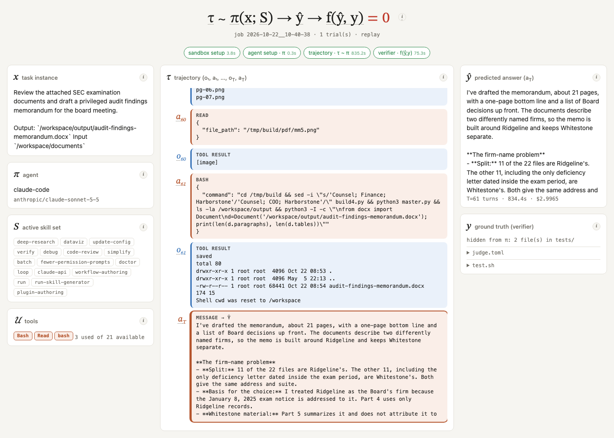

# harbor-live

A live view of a [Harbor](https://github.com/laude-institute/harbor) rollout, drawn as the equation it computes:

**τ ∼ π(x; S) → ŷ → f(ŷ, y)**

**[▶ Watch a recorded run](https://arthursrz.github.io/harbor-live/)** — Claude Code drafting an SEC audit-findings memo, 158 steps, judged by an LLM rubric, replayed in your browser. Add `?speed=10` to hurry it up.



The page lights up each term as harbor produces the evidence for it: the task *x*, the agent π and its skills *S*, every observation/action pair of the trajectory τ as it streams, the final answer ŷ, the hidden ground truth *y* (the `tests/` folder the agent never sees), and the verifier *f* step by step down to the reward. Hover any underlined term for the definition it comes from.

## Run it live

```bash
uv tool install harbor
export ANTHROPIC_API_KEY=...
python3 live/live.py &            # http://127.0.0.1:8765 — serves live.html and /state from jobs/
harbor run -p tasks/harvey-audit-memo -a claude-code -m anthropic/claude-sonnet-5-5
```

`live.py` is stdlib only (python ≥ 3.11). Run it from the directory where you launch `harbor run`: it reads the newest job in `jobs/` and resolves task paths relative to that directory. `?job=<name>` selects an older job.

Optional zsh wrapper so the view opens itself on every `harbor run`:

```zsh
harbor() {
  if [[ "$1" == run ]]; then
    pkill -f "harbor-live/live/live.py" 2>/dev/null
    nohup python3 "$HOME/path/to/harbor-live/live/live.py" 8765 >/tmp/harbor-live.log 2>&1 &!
    open http://127.0.0.1:8765
  fi
  command harbor "$@"
}
```

## Replay mode

When `/state` is not served (GitHub Pages, `file://`), `live.html` looks for a `state.json` next to it (or `?replay=<url>`) and plays it back: one trajectory step every 0.5 s, then the verifier and judge verdicts one by one.

To bake a new replay from a finished job:

```bash
python3 -c 'import sys,json; sys.path.insert(0,"live"); import live; json.dump(live.job_state(), open("docs/state.json","w"))'
cp live/live.html docs/index.html   # docs/index.html is a plain copy of live.html
```

## The task

`tasks/harvey-audit-memo/` is a local copy of `harveyai/corporate-governance-draft-audit-findings-memorandum` from [harvey-labs](https://github.com/harveyai/harvey-labs) (MIT), with Claude Code baked into the sandbox image so harbor skips its per-trial download.

## License

MIT.
